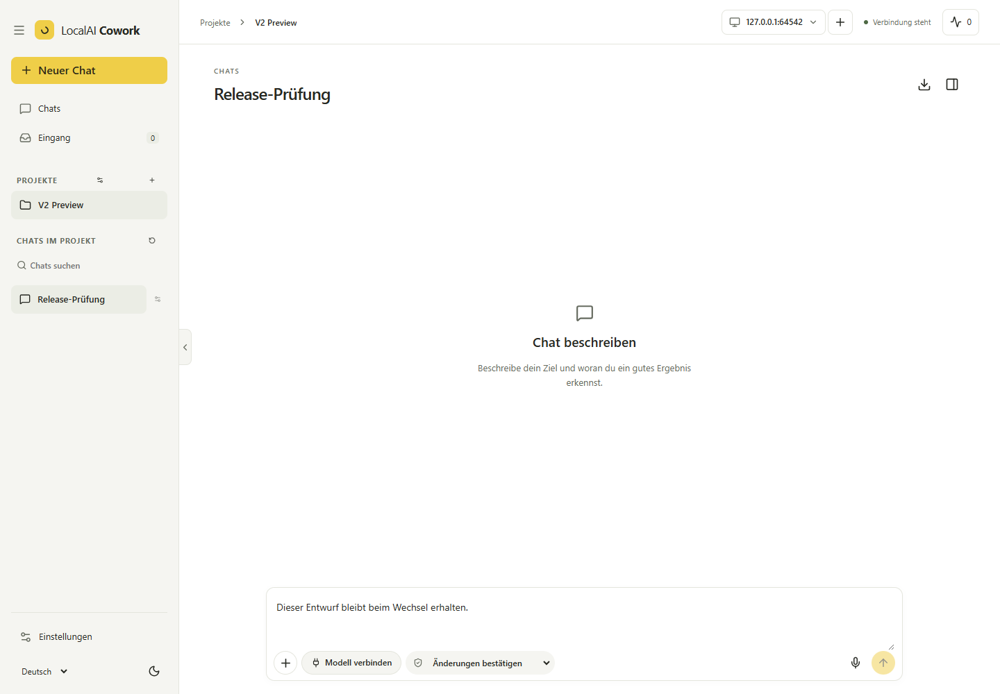

# LocalAI Cowork V2

A local-first, open-source workspace for AI-assisted work on Windows and Linux.
Choose a local Ollama model or compatible hosted endpoint, provide selected
context, review the execution plan and inspect the resulting files.

**Next preview: `2.0.0-alpha.8` — release preparation, not published yet.**
The existing project and Git history are preserved. V2 is the app at the root;
the independently versioned Enterprise server is under [enterprise/](enterprise/README.md).



[Website](https://noshitcoding.github.io/LocalAI-Cowork/) ·
[Deutsch](https://noshitcoding.github.io/LocalAI-Cowork/de/) ·
[Preview scope](docs/PREVIEW-SCOPE-2.0.0-alpha.8.md) ·
[Release notes](docs/RELEASE-NOTES-2.0.0-alpha.8.md) ·
[Documentation](docs/README.md)

## What V2 includes

- Projects and chats with selected files, model configuration, MCP tools,
  explicit approvals and confirmed execution plans.
- Workflows with typed inputs, connected results, conditions, branches,
  relative waits and editable human review forms.
- Guided document selection, source inspection, optional document engines,
  German/English OCR and reviewable extraction proposals.
- Project and personal knowledge with topic folders, notes, imports and graphs
  built from tags and sources.

Availability depends on configured models, tools, connection, execution target
and current permissions. Managed runtimes, remote result adoption, the complete
invoice workflow and multi-device/Enterprise operation retain separate
integration and acceptance requirements.

## Downloads and requirements

Package targets are Windows x64 NSIS and Linux x86_64 DEB/AppImage. Linux needs
**glibc 2.39 or newer**, GTK 3 and WebKitGTK 4.1. RPM, macOS, ARM64, musl-only
Linux and Android are outside this desktop preview.

The [V2 release destination](https://github.com/noshitcoding/LocalAI-Cowork/releases/tag/v2.0.0-alpha.8)
becomes a download only after publication and package acceptance. Existing
[V1 v0.3.1 downloads](https://github.com/noshitcoding/LocalAI-Cowork/releases/tag/v0.3.1)
remain in release history; those downloads do not contain V2.

Use a separate V2 profile and copies of working files. Keep V1 and a backup of
its data. Never open a V1 database directly with V2. Historical import requires
separate review and does not reactivate old credentials, runs, approvals or
schedules. No automatic V1-to-V2 upgrade is promised.

## Build and develop

Use `rust-toolchain.toml` and the npm version declared in `package.json`.

```sh
npm ci
npm run contracts:check
npm run typecheck
npm test
npm run build
cargo fmt --all -- --check
cargo clippy --locked --workspace --all-targets -- -D warnings
cargo test --locked --workspace
```

Run `npm run daemon` and `npm run dev` for local development. Native packaging
uses the [desktop release tools](docs/DESKTOP-RELEASE.md). Release bytes need
their own source revision, checksums, SBOM, signing/update status and installed
acceptance evidence.

Choose the correct [self-hosting path](docs/PUBLIC-SELF-HOSTING.md). V2 and
Enterprise have separate workspaces, lockfiles, server contracts and profiles.
`enterprise/app/` is retained for Enterprise dependencies and its management
web frontend; it is not the current V2 desktop app.

[Contribute](CONTRIBUTING.md) · [Support](SUPPORT.md) ·
[Security](SECURITY.md) · [Apache-2.0](LICENSE)
