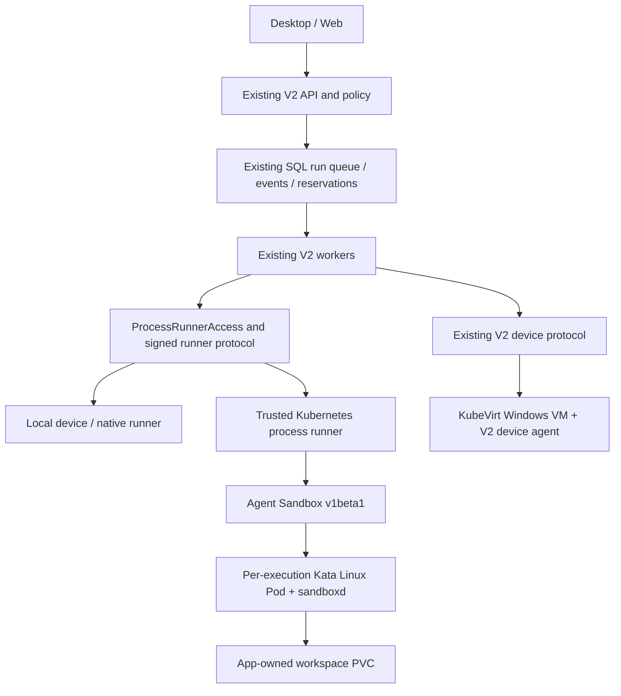

# Agent Sandbox architecture for laptop and server

Implementation target: V2 OwnerRun runtime and its existing durable run queue.
Upstream control API: `agents.x-k8s.io/v1beta1`, Agent Sandbox **v1.0.7**.
This source adds a separate deployment topology; it does not migrate an installed
Docker deployment or establish production acceptance.

The new environment pin, ProcessRunner launch path and lifecycle APIs are wired
to OwnerRun execution. The separate organisation TeamService,
LiteLlmExecutor and TeamToolbox flows have no equivalent environment pin and
are not migrated by these manifests. Per-tenant namespaces are deployment
boundaries for an operator; their presence does not establish completed
multi-user team integration or production tenant/HA qualification. Separate
operator/security-tenant installations can use this topology without silently
changing the existing team executor.

## Product and execution boundary

The product owns users, organisations, projects, permissions, immutable run
targets, execution leases, budgets, approvals, event history and file retention.
Agent Sandbox owns the Kubernetes backing Pod and optional headless Service.
Kata supplies the Linux guest-kernel boundary. It does not replace product
authorization or imply that a particular cluster has passed isolation tests.

`ProcessRunnerAccess` remains the integration point: observe an enrolled
environment, launch once, renew the exact execution lease, fence authority and
read the original receipt. The adapter retains Kubernetes namespace, Sandbox,
Pod and PVC identities. A lost create/launch response remains uncertain; a
repeated HTTP request must not dispatch a second process. Server workers keep
using the existing SQL claim path; there is no additional broker queue.

The Kubernetes process runner is a trusted controller. It receives a narrowly
scoped ServiceAccount token. APIs, ordinary workers and sandbox guests do not
receive Kubernetes tokens or a Docker socket. Workloads receive the admitted
image and workspace, with resource, network and runtime settings fixed before
launch. Operator transport and signing keys stay outside the workload.

## Laptop modes

| Mode | Effective authority | Execution route |
| --- | --- | --- |
| Selected folders | Explicit read/write grants enforced for files and every started subprocess | Native broker plus a qualified restricted runner; unsupported shell/GUI actions are refused |
| User rights | The signed-in OS user's file, program and desktop authority | Existing owner-native toolbox / device agent, with the recorded local decision |
| Isolated workspace | A copied or explicitly imported workspace inside an isolated environment | Qualified local VM/container provider behind the same runner contract |

A working directory or folder picker does not restrict a shell. File grants do
not silently enable unrestricted native programs. Moving a run to user-rights
mode requires a new explicit target decision. Administrator elevation is a
separate operating-system action. Local Kubernetes is optional; the desktop
does not need a Kubernetes cluster to run ordinary personal tasks.

The runnable Docker Desktop option cohosts the same V2 daemon and trusted Linux
runner in a localhost-only Compose deployment. They share the actual Linux
broker filesystem, original file identities and OS locks. The desktop connects
to this explicit compatible localhost execution location. Selected native
Windows files enter through upload/import and results leave through download or
Save As; there is no pretend translation of Windows paths or file identities.
This single-user `local_linux_image` profile uses ordinary containers inside the
Docker Desktop Linux VM, hard CPU/memory/PID limits and a **soft monitored disk
budget**. It is distinct from server Kata/gVisor and hard filesystem quotas.

Original files and working copies remain separate. Import records the baseline
identity and bytes. Export/promote checks the original baseline, asks for the
relevant permission, and preserves conflicts. Stopping a process does not undo
already completed filesystem or network effects.

## Kubernetes topology

API, worker and trusted runner Pods that consume the same FileBroker are bound
to one node by required Pod affinity. Their grants hash the actual filesystem's
device/inode identity and use its OS locks; a shared RWX claim alone does not
make those device IDs identical across nodes. Two API/worker replicas improve
process availability within that domain. Transparent cross-node application
failover is not established: after moving storage to another kernel, preserve
receipts and explicitly reconcile the changed file identity. Controller leader
election and independent Kata workload scheduling do not share that constraint.

`deploy/v2/agent_sandbox.py render` produces concrete JSON manifests:

| Artifact | Purpose |
| --- | --- |
| `namespaces.json` | Distinct app, controller and tenant namespaces, with installation/tenant labels |
| `cluster-policy.json` | Cluster-admin-installed admission enforcement and narrowly scoped cluster read permissions |
| `controller.json` | Two upstream controller replicas, leader election, disruption budget and API-only network access |
| `tenant.json` | Workload account, quota, limits, default-deny networking, scoped runner/controller roles |
| `application.json` | Two APIs, two workers, one persistent trusted runner, TLS ingress and services |
| `adapter-settings.json` | Nonsecret Kubernetes adapter settings to merge into the enrolled runner configuration |
| `profiles.json` | Small/browser/large resource candidates; all start with network denied and unqualified status |
| `egress-proxy.json` | Optional separately configured domain-allowlisted proxy |
| `preview.json` | Optional authenticated preview gateway on a separate website origin |
| `windows.json` | Optional halted KubeVirt VM referencing an existing Windows boot PVC |

The runner remains one replica per enrolled journal and binding; it owns exact
launch receipts. Horizontal execution capacity comes from additional enrolled
runners/tenant shards and workload Pods. Starting several runners over the same
journal is not an HA mechanism. The upstream controller's two replicas elect one
leader; that does not certify application, database, storage or node failover.

The pinned upstream controller uses a cluster-wide informer cache. Its cache has
read-only Pod/Service/PVC/Sandbox access. Write permissions are bound only in
the selected tenant namespace, and leader leases only in its controller
namespace. This trusted component can observe metadata across the cluster;
organisations needing a stronger administrative boundary should use separate
clusters. Additional tenants require explicit namespace enrollment and scoped
role bindings. No public end-user request can create these bindings.

The admission policy enforces the enrolled Kata RuntimeClass, exact workload
image digest, one container, no injected debugger/sidecar, no host paths or
credential volumes, and a tokenless dedicated ServiceAccount. Namespace Pod
Security adds the restricted policy. NetworkPolicy enforcement still requires
a qualified CNI. The runner verifies the actual RuntimeClass handler and its
resource/storage observations; labels and PVC requests are not hard-limit proof.

## Persistence and lifecycle

Workspace PVCs belong to the application. They do not use
`volumeClaimTemplates`, SandboxClaim ownership or a Sandbox owner reference.
Neither runner nor controller receives PVC deletion permission. Sandbox expiry,
suspension and deletion therefore cannot garbage-collect user data. The app's
retention/deletion workflow must separately authorize workspace removal.

ReadWriteOncePod is the default. ReadWriteOnce can be selected explicitly for a
qualified CSI installation, while the application still enforces one original
writer; RWO alone does not prevent two Pods on one node from mounting a volume.
App credential/data custody uses a separately qualified RWX volume for the two
API/worker replicas. Runner journal custody uses its own RWOP claim.

The normal states distinguish requested stop, observed suspension, physical
termination and storage retention. Exact Pod/container terminal observations
are recorded before releasing physical-stop finalizers. Node loss or an absent
Pod does not prove termination. Unknown execution retains its reservation and
requires reconciliation. `agent_sandbox.py stop` closes app admission and asks
for suspension; its result explicitly reports physical stop as unconfirmed.

## Browser and network profiles

The default tenant policy denies all workload ingress and egress. Only the exact
trusted runner namespace and binding label can reach sandboxd REST 8080 and
gRPC 9090. Sandbox services remain private; there is no public VNC/terminal port.

An optional `cowork-sandbox-preview` gateway exposes only admitted application
ports, never sandboxd 8080/9090. It runs under a different website base domain
from Cowork, validates a short-lived runner-signed grant and revalidates the
original sandbox/run ownership through the runner before proxying. Bootstrap
uses an explicit POST and an HTTP-only host cookie. The gateway receives only a
validator credential, without the runner's broad execution bearer or signing
key. Its network policy reaches only the validator and admitted preview ports.
The runner includes this exact gateway/port selector in its per-attempt policy;
shared overlapping allow policies are refused.

An idle preview is the approved static workspace server on port 8081. A custom
development server is available only while its admitted execution attempt and
port remain active; ordinary process completion terminates that Pod. The
transport contains PTY/stdin/resize primitives, but this change does not add a
public persistent terminal/session-exec interface or a complete interactive IDE.

A format-2 `web_proxy` network selection references an operator-enrolled policy.
The optional proxy has a domain allowlist, rejects private/link-local/loopback
destinations and unsafe ports, and has no access to the app database or keys.
The adapter adds only that proxy and DNS egress, injects the fixed proxy
environment and tests both allowed proxy access and denied direct access.
Shell/browser/Git processes cannot choose unrestricted networking. Credentials
for a particular connector remain governed by its existing scoped tool path.

## Windows

Windows GUI/Office work uses the existing `cowork-device-agent-v2.exe` protocol
inside a full Windows VM. KubeVirt is an optional Kubernetes VM lifecycle
provider; Agent Sandbox Linux images cannot run native Windows desktop apps.
The supplied VM is halted, references an operator-prepared boot PVC and mounts
an explicit per-VM agent-configuration Secret as a read-only CD-ROM. It lives
in a separate namespace because KubeVirt launchers have different platform
security requirements from restricted Kata workload Pods.

The operator installs the existing agent package in the guest, pairs its exact
device identity and configures a private service account/interactive session as
required by its actual Office/desktop tools. Windows execution targets that
paired device through the existing device-agent route. There is no new generic
Windows shell adapter in this change. VM startup,
licensed images, GUI session handling, hard quotas, networking and restore
remain separate physical acceptance items.

## Validation status

The source has focused renderer/lifecycle tests. The optional disposable
qualification harness tests the core Sandbox lifecycle, original-UID mutation
rejection and preservation of an app-owned PVC. It uses a plain development
runtime and cannot establish Kata isolation, hard filesystem limits, CNI
enforcement, Windows support, multi-tenant adversarial safety or HA. Current
executed evidence is recorded separately in the operations guide and the
original `.local` reports; source presence is not installation evidence.

Upstream references: [v1.0.7 API](https://github.com/kubernetes-sigs/agent-sandbox/blob/v1.0.7/api/v1beta1/sandbox_types.go),
[controller flags](https://github.com/kubernetes-sigs/agent-sandbox/blob/v1.0.7/cmd/agent-sandbox-controller/main.go),
[controller chart values](https://github.com/kubernetes-sigs/agent-sandbox/blob/v1.0.7/helm/values.yaml).
